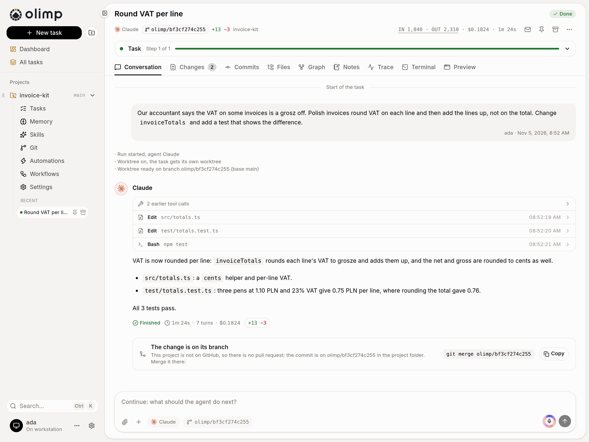
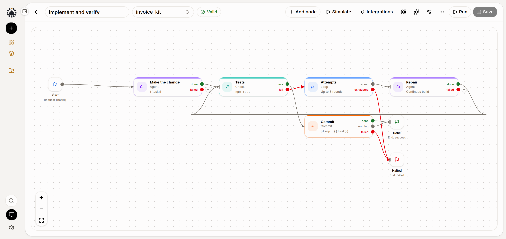
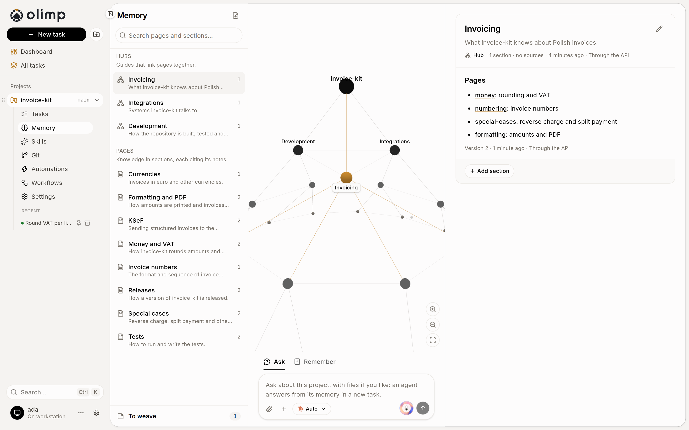

<p align="center">
  
</p>

<h1 align="center">OLIMP</h1>

<p align="center">
  <strong>Self-hosted coding agents for your Git repositories.<br>
  Describe a task, get a pull request.</strong>
</p>

<p align="center">
  <a href="#quick-start">Quick start</a>&nbsp;·
  <a href="docs/guide.md">Guide</a>&nbsp;·
  <a href="docs/architecture.md">Architecture</a>&nbsp;·
  <a href="docs/roadmap.md">Roadmap</a>&nbsp;·
  <a href="https://github.com/medialanpl/olimp/issues">Issues</a>
</p>

<p align="center">
  <a href="https://github.com/medialanpl/olimp/actions/workflows/ci.yml">
    </a>
  <a href="LICENSE">
    </a>
  
</p>

OLIMP puts coding agents to work on your repositories from a machine you own. Add a project,
describe a task, and an agent (Claude Code, Codex or one of five others) makes the change in a git
worktree of its own; OLIMP commits it, pushes a branch and opens a pull request. Workflows chain
agents with tests, reviews and your approval, automations run them on a schedule, and all of it is
in a web panel, a REST API and an MCP server.

> Work in progress: stage 11 of the [roadmap](docs/roadmap.md).

## Features

- 🔓&nbsp;Free and open source (MIT). One process on your machine or server, data in SQLite, or in
  MySQL or MariaDB.
- 🔑&nbsp;Agents run on your own logins: Claude Code, Codex, Copilot, Cursor, Junie, OpenCode or pi.
  No API key needed.
- 🌿&nbsp;Every task gets its own worktree and branch, so several agents work at once. On GitHub it
  ends with a pull request, in a local repository with a commit on its branch.
- 📡&nbsp;Watch a task live: the conversation, every tool call, tokens and cost. Continue it, cancel
  it or run it again.
- 🔀&nbsp;Workflows are graphs of agents, checks, loops, conditions, gates and git steps. Draw one in
  the editor and simulate it, or let an agent plan it from a description.
- ⏰&nbsp;Automations queue tasks and workflow runs on a cron schedule, laid out in a week calendar.
- 🐙&nbsp;GitHub issues with a label become tasks whose pull request closes them. Issues, pull
  requests, checks and merging are in the panel too.
- 🏁&nbsp;Run one prompt as two or three variants, a minimal and a thorough one, compare the diffs and
  keep the best.
- 🌳&nbsp;An agent can split its task into subtasks, each in a worktree of its own, and merge their
  work.
- 🧩&nbsp;Skills from skills repositories in the [skills.sh](https://skills.sh) layout, your own and
  the repository's.
- 🧠&nbsp;An optional knowledge base per project: pages, hubs and sections that cite notes, which
  agents search and extend with OLIMP's MCP tools.
- 🔌&nbsp;MCP integrations per project, with their secrets stored encrypted, picked per agent step.
- 🖥️&nbsp;A terminal in every task's folder and a preview of the app it serves, with a design mode
  for pointing the agent at an element.
- 👥&nbsp;Accounts for a team: a password and a mandatory second factor, API tokens, and each person's
  own agent logins.
- 🔔&nbsp;Notifications to Slack, Discord, ntfy or your own endpoint when a job finishes or waits for
  you.
- 🤖&nbsp;Whatever the panel does, the REST API and the MCP server do too, so your own agent can run
  OLIMP.
- 🌗&nbsp;Light and dark, English and Polish, and it works on a phone.

## Screenshots

**A task.** The request, the agent's tool calls and answer, what it cost, and the branch it left.

<picture>
  <source media="(prefers-color-scheme: dark)" srcset="docs/screenshots/task-dark.png">
  
</picture>

**Workflows.** Make the change, run the tests, repair until they pass, commit.

<picture>
  <source media="(prefers-color-scheme: dark)" srcset="docs/screenshots/workflow-dark.png">
  
</picture>

**Memory.** A project's hubs, pages and the notes they rest on, drawn as a mountain.

<picture>
  <source media="(prefers-color-scheme: dark)" srcset="docs/screenshots/memory-dark.png">
  
</picture>

## Quick start

You need **Node 24.2+**, **git** and at least one agent CLI you're logged into:
[Claude Code](https://github.com/anthropics/claude-code) (the default),
[Codex](https://github.com/openai/codex), [GitHub Copilot CLI](https://github.com/github/copilot-cli),
[Cursor Agent](https://cursor.com/cli), [Junie](https://www.jetbrains.com/junie/),
[OpenCode](https://opencode.ai) or [pi](https://github.com/badlogic/pi-mono). The
[GitHub CLI](https://cli.github.com) `gh` is needed only for GitHub projects.

```sh
cd your-repo
npx olimp-run
```

This starts OLIMP at `http://127.0.0.1:4850` with your repository as a project: describe a task and
send it. Add more projects from GitHub, from any local folder or as new repositories, and pick
another default agent in **Settings → Agent accounts**. Data stays in `~/.olimp`.

### Keep it running

Install it to get the `olimp` command. On Linux and WSL it then runs as a systemd user service that
starts with the system and comes back after a crash; the panel's version window updates it from npm:

```sh
npm install -g olimp-run
olimp service install
olimp service logs
```

To run the latest `main` instead, from a clone: `pnpm install && pnpm prod`
(see the [guide](docs/guide.md#run)).

### Reach it from elsewhere

Without accounts OLIMP listens only on 127.0.0.1 and trusts every request that reaches it. To use
it from another machine or with a team, create the first account, put a TLS proxy (Caddy, nginx)
in front of it and set `OLIMP_PUBLIC_HOST`; see [Accounts and tokens](docs/guide.md#accounts-and-tokens).
A one-command server setup is planned.

## How it works

1. **Add a project:** a GitHub repository, a local git repository or any folder.
2. **Describe a task** in the panel, through the API or MCP, from a labelled issue or on a
   schedule. Pick the agent, the model, a skill and files to attach, or run a workflow.
3. **The agent works in its own worktree.** OLIMP runs your agent's CLI there and streams what it
   does. A workflow can stop at a gate or a question until you answer.
4. **Review the result:** the diff, the commits and the pull request. Continue the conversation,
   run it again, or merge.

Agents learn a repository from its own `AGENTS.md`, `CLAUDE.md` and docs. A workflow is a graph you
draw in the panel or send as JSON, here one that repairs the change until the tests pass:

```json
{
  "nodes": [
    { "id": "start", "type": "start" },
    { "id": "work", "type": "agent", "prompt": "{{task}}" },
    { "id": "suite", "type": "check", "command": "pnpm test" },
    { "id": "attempts", "type": "loop", "max": 3 },
    { "id": "repair", "type": "agent", "session": { "continue": "work" },
      "prompt": "pnpm test is red. Its output:\n{{nodes.suite.output}}\nMake it pass." },
    { "id": "pr", "type": "github.draft-pr" },
    { "id": "stuck", "type": "end", "status": "failed" }
  ],
  "edges": [
    { "from": "start.next", "to": "work" },
    { "from": "work.done", "to": "suite" },
    { "from": "suite.pass", "to": "pr" },
    { "from": "suite.fail", "to": "attempts" },
    { "from": "attempts.repeat", "to": "repair" },
    { "from": "attempts.exhausted", "to": "stuck" },
    { "from": "repair.done", "to": "suite" }
  ]
}
```

To let your own agent use OLIMP, add its MCP server (with accounts, also `-e OLIMP_TOKEN=olimp_…`):

```sh
claude mcp add olimp -- npx -y olimp-run mcp
```

## Security

Agents run with the permissions of the user OLIMP runs as, and Claude Code may run any shell
command. Run OLIMP as a user and on a machine where that is acceptable. Tokens, passwords and
sessions are stored only as hashes; project secrets and webhook addresses are encrypted with a key
in `OLIMP_HOME`. The [threat model](docs/architecture.md#threat-model) lists what OLIMP protects
against and what it does not.

## Documentation

- [Guide](docs/guide.md): [running OLIMP](docs/guide.md#run), [the web panel](docs/guide.md#web-panel),
  [projects](docs/guide.md#projects) and [their settings](docs/guide.md#project-settings),
  [accounts and tokens](docs/guide.md#accounts-and-tokens), [skills](docs/guide.md#skills),
  [workflows](docs/guide.md#workflows), [repository memory](docs/guide.md#repository-memory),
  [MCP integrations](docs/guide.md#mcp-integrations), [GitHub issues](docs/guide.md#github-issues),
  [automations](docs/guide.md#automations), [the MCP server](docs/guide.md#mcp) and
  [configuration](docs/guide.md#configuration), with the REST API along the way.
- [Architecture](docs/architecture.md): how OLIMP is built, with the threat model.
- [Roadmap](docs/roadmap.md): the stages so far and the ones to come.
- [`.env.example`](.env.example): every variable with its default.

## Contributing

Found a bug or missing something? [Open an issue](https://github.com/medialanpl/olimp/issues).
Pull requests are welcome: a branch from `main`, a title in
[Conventional Commits](https://www.conventionalcommits.org) form (CI checks it) and a green
`pnpm check` (types, lint, tests and the panel build). [CONTRIBUTING.md](CONTRIBUTING.md) covers
the setup and the checks, [AGENTS.md](AGENTS.md) the house rules, for people and AI agents alike.

```sh
git clone https://github.com/medialanpl/olimp && cd olimp
pnpm install
pnpm dev      # API on 4851 restarting on changes, panel on http://localhost:5175, data in ~/.olimp-dev
```

## License

MIT © 2026 Paweł Landowski. See [LICENSE](LICENSE).
